# JeevanCare 🩺

### A Healthcare Consultation Platform

JeevanCare is a web-based healthcare consultation platform designed to connect patients, doctors, and administrators through a simple and accessible interface. It provides dedicated dashboards and features for patient registration, doctor profiles, consultation management, and administrative workflows.

## 🌐 Live Demo

- **Live Website:** https://jeevancaree.netlify.app/
- **Backend API:** https://jeevancare-mnn4.onrender.com/
- **Health Check:** https://jeevancare-mnn4.onrender.com/api/health
- **GitHub Repository:** https://github.com/rishu92/JeevanCare

## ✨ Features

- **User Authentication:** Patient and doctor registration, login, and password hashing.
- **Patient Dashboard:** Dedicated dashboard and profile management interface.
- **Doctor Profiles:** Browse doctors and view their professional profiles.
- **Doctor Dashboard:** Dedicated interface for doctors to manage consultation workflows.
- **Doctor Verification:** Doctor document submission and administrative verification workflows.
- **Consultation Management:** Patient consultation requests and doctor-side consultation handling.
- **Chat Interface:** Dedicated interface for consultation-related communication.
- **AI Assistant:** Healthcare information and general symptom guidance interface.
- **Emergency Assistance:** Emergency information and assistance page.
- **Admin Panel:** Administrative interface for managing doctors and platform workflows.
- **Responsive Web Interface:** HTML, CSS, and JavaScript-based user interface.

*Feature availability may depend on backend configuration, database state, and external service configuration. JeevanCare is an academic project and is not a substitute for professional medical advice or emergency care.*

## 📸 Screenshots

### Homepage
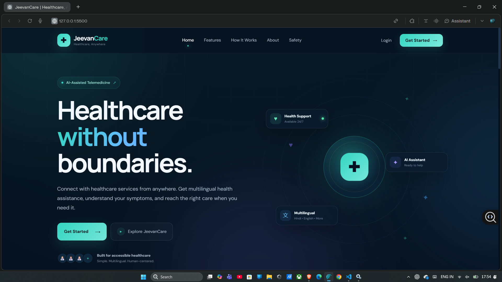

### Patient Dashboard
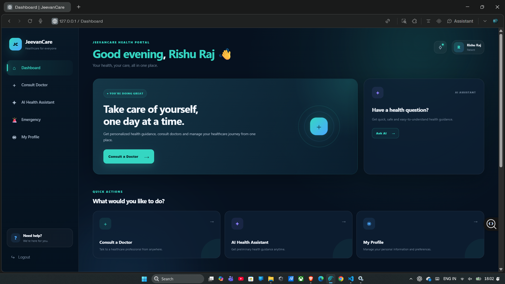

### Doctor Listing
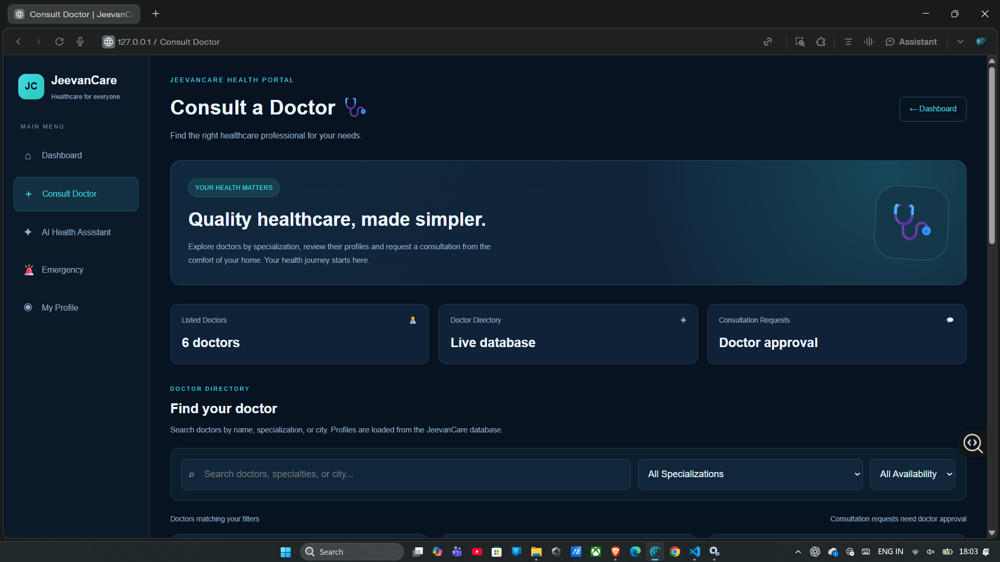

### Doctor Dashboard
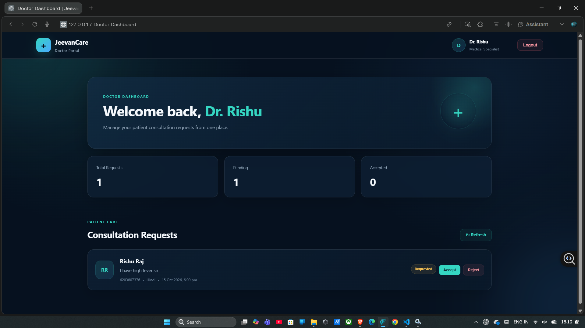

### Admin Panel
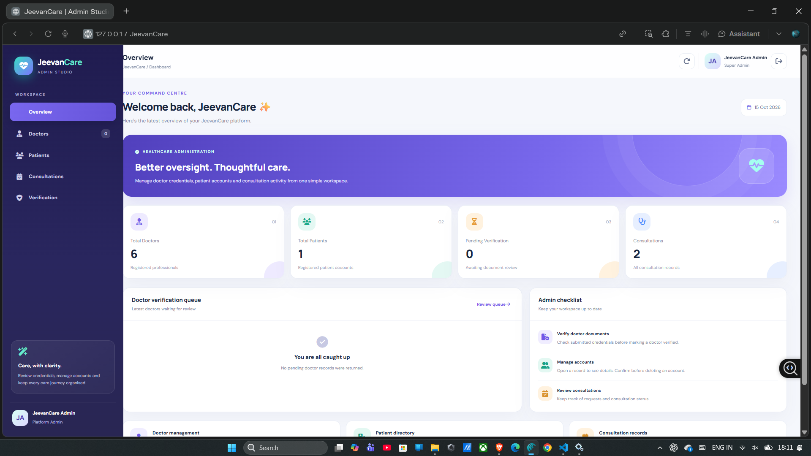

### Login Page
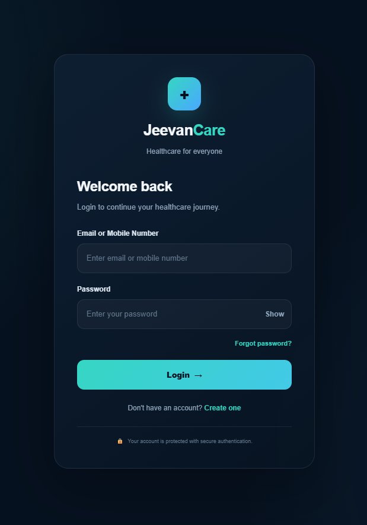

### Registration Page
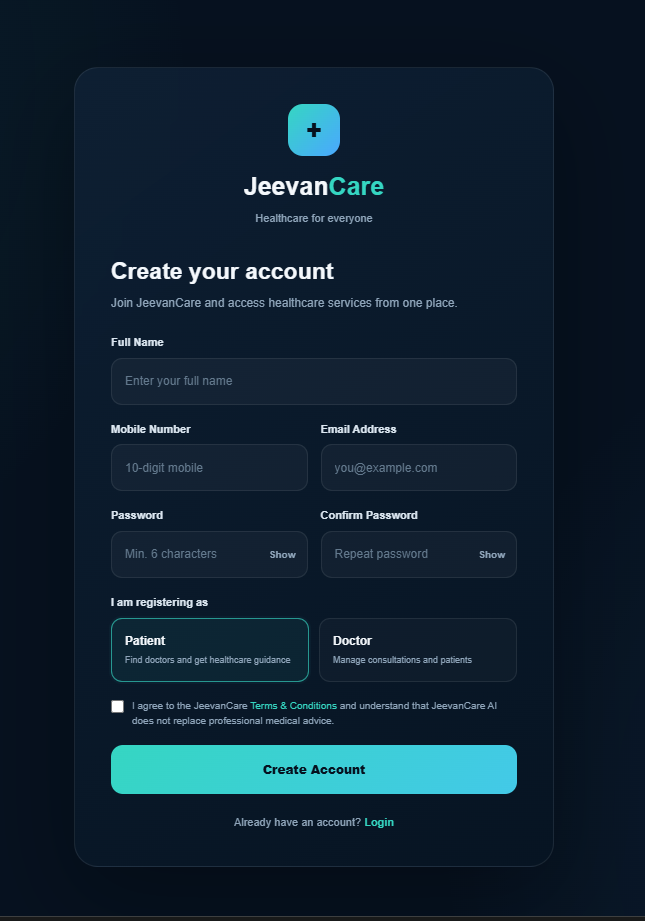

### Doctor Documents
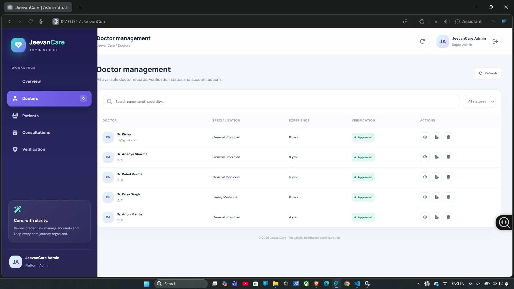

### Chat Interface
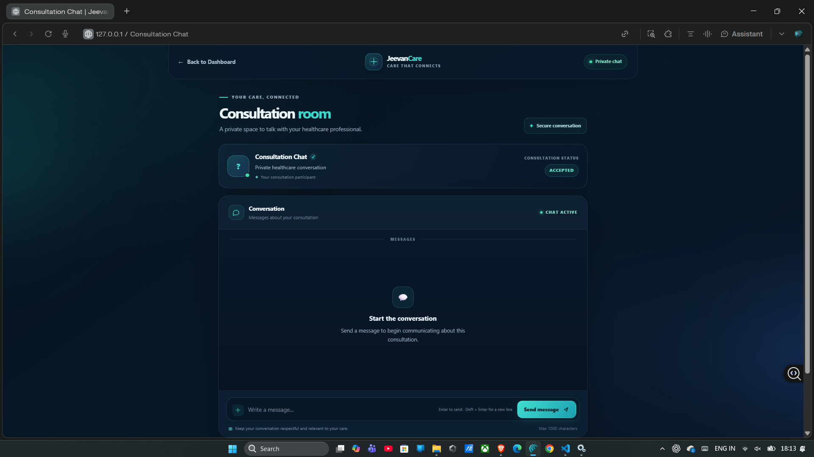

### Emergency Assistance
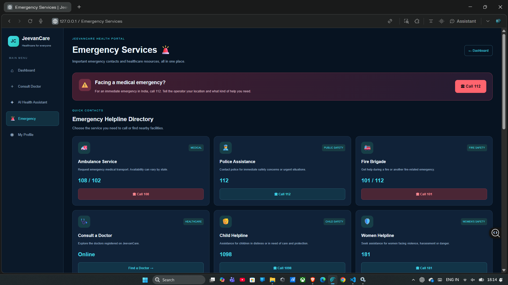

### AI Assistant
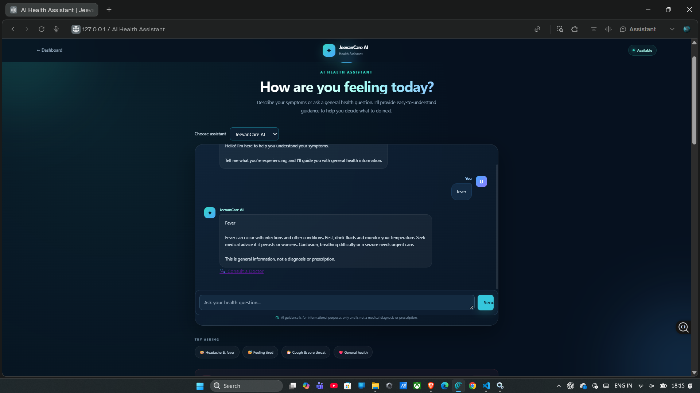

## 🛠️ Tech Stack

| Component | Technology |
|---|---|
| Frontend | HTML5, CSS3, JavaScript |
| Backend | Node.js, Express.js |
| Database | TiDB Cloud (MySQL-compatible) |
| Authentication | bcryptjs, JSON Web Tokens (JWT) |
| API Communication | REST APIs |
| Version Control | Git, GitHub |
| Frontend Hosting | Netlify |
| Backend Hosting | Render |

## 📁 Project Structure

```text
JeevanCare/
├── assets/
├── backend/
│   ├── config/
│   ├── controllers/
│   ├── middleware/
│   ├── routes/
│   ├── package.json
│   └── server.js
├── css/
├── js/
├── screenshots/
├── server/
├── index.html
├── admin.html
├── ai-assistant.html
├── chat.html
├── dashboard.html
├── doctor.html
├── doctor-dashboard.html
├── doctor-documents.html
├── doctor-profile.html
├── emergency.html
├── login.html
├── otp.html
├── profile.html
├── register.html
├── package.json
└── README.md
```

## ⚙️ Local Installation and Setup

### Prerequisites

Install the following tools:

- [Node.js](https://nodejs.org/)
- npm
- [Git](https://git-scm.com/)
- [Visual Studio Code](https://code.visualstudio.com/)
- A MySQL-compatible database, such as MySQL or TiDB
- VS Code Live Server extension (optional, for frontend development)

### 1. Clone the Repository

```bash
git clone https://github.com/rishu92/JeevanCare.git
cd JeevanCare
```

### 2. Install Backend Dependencies

```bash
cd backend
npm install
```

### 3. Configure Environment Variables

Create a `backend/.env` file using the variable names expected by the backend configuration.

Example:

```env
PORT=5000
DB_HOST=your_database_host
DB_USER=your_database_username
DB_PASSWORD=your_database_password
DB_NAME=jeevancare
DB_PORT=4000
JWT_SECRET=your_secure_random_secret
```

Use the correct database host, port, username, and credentials for your environment. The example above is illustrative; local MySQL installations commonly use port `3306`, while the deployed TiDB configuration may use a different port.

Never commit `.env` files, database credentials, API keys, or JWT secrets to GitHub.

### 4. Set Up the Database

1. Create a database named `jeevancare`.
2. Create the tables required by the backend.
3. Configure the database connection in the environment variables.
4. Ensure the database user has the necessary permissions.

Use the project's existing database schema and setup scripts as the source of truth for the required tables and columns.

### 5. Start the Backend

From the `backend` directory, run:

```bash
npm start
```

This command assumes the backend's `package.json` defines a `start` script.

### 6. Run the Frontend

Open the project root in Visual Studio Code and use the Live Server extension to serve the frontend HTML pages.

For local development, ensure the backend's CORS configuration permits your local frontend origin.

## 🚀 Deployment

JeevanCare uses separate hosting services for its frontend and backend:

- **Frontend:** Deployed on Netlify.
- **Backend:** Deployed on Render.
- **Database:** Hosted on TiDB Cloud.

The frontend API URLs must point to the deployed backend, and the backend CORS configuration must allow the frontend's origin.

## 🔒 Security Notes

- Passwords are hashed before being stored in the database.
- Protected API routes use authentication middleware where configured.
- Keep database credentials and secret keys private.
- Do not expose admin credentials in source code, screenshots, or public documentation.
- Use test accounts when demonstrating the application.

## 🎓 Project Information

**Project:** JeevanCare — Healthcare Consultation Platform  
**Author:** Rishu Raj  
**Degree:** B.Tech in Computer Science and Engineering  
**University:** Galgotias University

## 📄 License

No license has been specified for this repository. Contact the repository owner for permission before reusing or redistributing the project.
